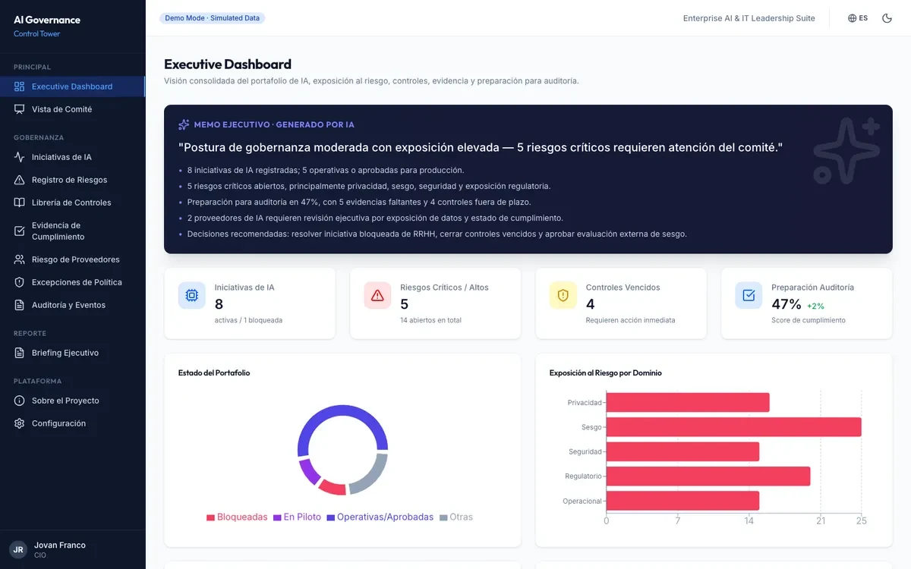
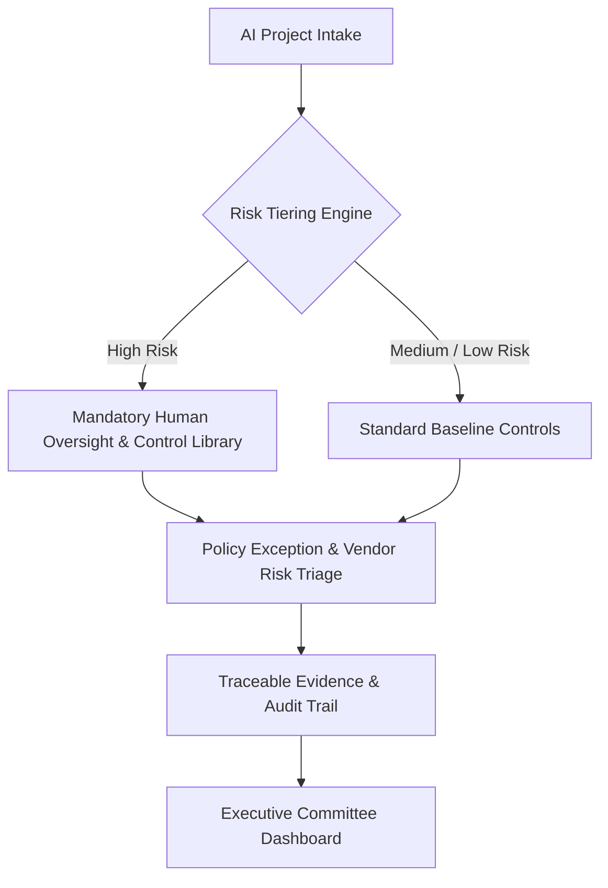

# AI Governance Control Tower — Executive Showcase

  

  <strong>Enterprise-oriented AI governance decision-support architecture</strong> 
  ISO/IEC 42001-inspired alignment &amp; NIST AI Risk Management Framework (RMF) functional scope

  <a href="https://ai-governance-control-tower.vercel.app/"><strong>Live Interactive Web Application</strong></a> •
  <a href="https://www.jovanfranco.com"><strong>Website &amp; Executive Insights</strong></a> •
  <a href="https://github.com/jovfranco-tech"><strong>GitHub Profile</strong></a>

---

## Executive Overview & Purpose

The **AI Governance Control Tower (AGCT) — Executive Showcase** (`ALORIA-REPO-005`) is a documentation-only architectural portfolio showcase designed for Chief Information Officers (CIOs), Chief AI Officers (CAIOs), and Enterprise Risk Committees.

### Problem It Addresses

Enterprise AI adoption often fragments across shadow pilots, inconsistent risk assessments, untracked policy exceptions, and disconnected vendor reviews. This showcase illustrates a unified governance decision-support lifecycle—connecting AI use-case intake risk scoring, control selection, policy exception governance, third-party vendor risk triage, and audit-ready evidence traceability—while preserving explicit human-in-the-loop accountability.

> [!NOTE]
> **Portfolio Showcase & Synthetic Data Scope**:
> This repository is strictly a **documentation-only portfolio showcase** (`classification: SHOWCASE_CANONICAL` in [`ALORIA_PRODUCT_STATE.yaml`](ALORIA_PRODUCT_STATE.yaml)). It contains **no application source code, package manifests, database migrations, or test suites**. The external live demonstration at [ai-governance-control-tower.vercel.app](https://ai-governance-control-tower.vercel.app/) operates with representative synthetic datasets and deterministic scenarios; it does not process real tenant data or confidential enterprise metrics, and it does not imply formal ISO/IEC 42001 certification, regulatory approval, operational deployment, or guaranteed compliance.

---

## Live Interactive Application

Experience the external interactive showcase interface in your browser:
- **Live Demo**: [AI Governance Control Tower](https://ai-governance-control-tower.vercel.app/)

---

## Capabilities Scope (Repository vs. External Showcase)

### Verified Artifacts in This Repository (`HEAD`)

- [`README.md`](README.md) — Executive architectural overview, governance workflow documentation, and reconciled showcase state.
- [`ALORIA_PRODUCT_STATE.yaml`](ALORIA_PRODUCT_STATE.yaml) — Canonical product state contract (`schema_version: "1.0"`, `state_date: "2026-10-07"`, `canonical_main_status: "CANONICAL_ACCEPTED"`).
- [`assets/control-tower-overview.webp`](assets/control-tower-overview.webp) — Executive dashboard overview visual asset.

### Conceptual Functional Capabilities (Demonstrated in External Live Showcase)

1. **AI Use-Case Intake & Risk Scoring**:
   - Structured risk tiering concepts based on impact, autonomy, data sensitivity, and regulatory exposure.
   - ISO/IEC 42001-inspired alignment and NIST AI RMF functional scope.
2. **Control Recommendation & Tracking**:
   - Conceptual mapping of baseline safety, transparency, bias mitigation, and data privacy controls.
   - Readiness visibility across organizational governance domains.
3. **Policy Exception & Vendor Risk Lifecycle**:
   - Workflow representation for policy exceptions, expiration dates, mitigating controls, and third-party AI vendor risk triage.
4. **Traceable Evidence & Audit Trail**:
   - Decision-to-evidence traceability linking governance outcomes to control documentation and human sign-offs.

### Out of Scope / Pending in This Repository

- **Application Source Code & Runtime**: Intentionally absent from this showcase repository; the underlying AGCT software product is governed under a separate authority (`software_closeable_remaining: "showcase is current on main; underlying AGCT product remains separate authority"`).
- **Production Tenancy, Live Telemetry & Statutory Certification**: Excluded by policy (`main_is_not_production_claim: true`, `technical_gold_is_not_third_party_certification: true`).

---

## Conceptual Architecture & Technology Context

The diagram below illustrates the conceptual governance workflow demonstrated by the AI Governance Control Tower showcase (conceptual architecture; no executable workflow engine resides inside this repository):

### Technology Stack Reconciliation

- **Contents Verified in This Repository**: Markdown documentation ([`README.md`](README.md)), YAML governance state contract ([`ALORIA_PRODUCT_STATE.yaml`](ALORIA_PRODUCT_STATE.yaml)), and WebP visual asset ([`assets/control-tower-overview.webp`](assets/control-tower-overview.webp)).
- **External Showcase Application Note**: No `package.json`, TypeScript/React source files, Tailwind/Vite configuration, Supabase migrations, or Vitest suites exist in this repository. Any UI/application stack powering the hosted demo at `https://ai-governance-control-tower.vercel.app/` resides in the separate underlying AGCT codebase and is not verifiable from files in this repository.

---

## Integrations & External References

- **Hosted Interactive Demo**: `https://ai-governance-control-tower.vercel.app/` (external showcase deployment; no deployment configuration files exist in this repository).
- **Author & Portfolio Links**: `https://www.jovanfranco.com` and `https://github.com/jovfranco-tech`.
- **Internal Repository Dependencies**: None (zero package manifests, API routes, MCP/A2A agent files, or third-party SDKs).

---

## Local Setup, Environment & Data Model

- **Installation & Local Execution**: Not applicable. This repository has no `package.json`, `Dockerfile`, build scripts, or local server entrypoints. To review the repository locally, clone the repository and inspect [`README.md`](README.md), [`ALORIA_PRODUCT_STATE.yaml`](ALORIA_PRODUCT_STATE.yaml), and [`assets/control-tower-overview.webp`](assets/control-tower-overview.webp).
- **Environment Variables**: None. No `.env`, `.env.example`, or code-referenced environment variables exist in this repository.
- **Data Model & Migrations**: None. Zero SQL schemas, ORM definitions, or migration files are stored in this repository; the external live demo uses synthetic, deterministic scenario data.

---

## Testing & Quality Evidence

- **Automated Test Suites in This Repository**: None (`0` test files and `0` `package.json` test scripts exist in this repository). Prior documentation references to Vitest cannot be verified from this repository's files because no source or test code is hosted here.
- **Repository Verification Performed (`2026-11-23`)**:
  - Tracked file inventory verified in `HEAD`: [`ALORIA_PRODUCT_STATE.yaml`](ALORIA_PRODUCT_STATE.yaml), [`README.md`](README.md), and [`assets/control-tower-overview.webp`](assets/control-tower-overview.webp).
  - Structural README checks (Markdown link resolution, Mermaid syntax checks, secret-pattern scan, and README-only diff scope) validated locally.

---

## Security, Privacy & Responsible AI Boundaries

- **Human-in-the-Loop Authority**: The Control Tower illustrates a decision-support architecture. Final approvals, policy exceptions, and risk acceptances always require explicit human authorization.
- **Non-Automated Compliance**: Reviewing or interacting with this showcase does not satisfy statutory or regulatory obligations without formal organizational audit, controls enforcement, and external evidence.
- **Zero Secrets / Zero Tenant PII**: This repository stores no credentials, API keys, `.env` files, or real tenant/customer data.
- **Contractual Evidence Boundaries** (from [`ALORIA_PRODUCT_STATE.yaml`](ALORIA_PRODUCT_STATE.yaml)):
  - `main_is_not_production_claim: true`
  - `technical_gold_is_not_third_party_certification: true`
  - `commercial_proof_is_separate: true`
  - `blind_merge_allowed: false`
  - `exact_sha_validation_required: true`
  - `preserve_non_claims: true`
  - `production_deploy_requires_explicit_authorization: true`

---

## Current Roadmap & Governance Status

Status reconciled as of `2026-11-23` against `HEAD`, [`ALORIA_PRODUCT_STATE.yaml`](ALORIA_PRODUCT_STATE.yaml) (`state_date: 2026-10-07`), and the Aloria Portfolio Roadmap Register (`2026-11-20`):

| Workstream / Scope | Status | Evidence & Notes |
| :--- | :--- | :--- |
| **Canonical Product State Contract** | `IMPLEMENTED` / `VERIFIED` | [`ALORIA_PRODUCT_STATE.yaml`](ALORIA_PRODUCT_STATE.yaml) merged on `main` (`canonical_main_status: CANONICAL_ACCEPTED`, `classification: SHOWCASE_CANONICAL`, `current_phase: showcase_current_main`). |
| **Executive Showcase Documentation & Visual Asset** | `VERIFIED` | `2/2` showcase artifacts ([`README.md`](README.md) and [`assets/control-tower-overview.webp`](assets/control-tower-overview.webp)) present on `main` (`canonical_candidate_sha: 6e0ad84671545c9f15bd77b0e1dae5b7bcf7b0be`, verified `2026-11-23`). |
| **Local App Source, Tests & CI/CD in This Repo** | `NOT_STARTED` | Intentionally out of scope for this documentation-only showcase (`0` source files, `0` test suites, `0` workflows in repo). |
| **Underlying AGCT Product Evidence & Production Claim** | `BLOCKED_EXTERNAL` | Separate product authority required; external gates defined in [`ALORIA_PRODUCT_STATE.yaml`](ALORIA_PRODUCT_STATE.yaml) (`underlying AGCT product evidence`, `no standalone production/certification claim`). Not `PRODUCTION_READY`. |

### External Blockers & Dependencies

1. **Underlying AGCT Product Authority**: Technical software evidence, build/test telemetry, and implementation artifacts live outside this showcase repository.
2. **Explicit Production Authorization**: Any production deployment or commercial/compliance claim requires separate authorization and third-party audit evidence (`production_deploy_requires_explicit_authorization: true`).
3. **Portfolio Register Alignment**: Classified in the Aloria Portfolio Register (`2026-11-20`) under the 15 *Showcases, Sandboxes, Labs, Websites & Demos* (non-production; zero live secrets or unapproved PII/claims).

---

## Deployment & Operations

- **Repository CI/CD & Infra**: None (`0` `.github/workflows/*` or infrastructure manifests in this repository).
- **External Demo Hosting**: The live showcase interface is served externally at `https://ai-governance-control-tower.vercel.app/` outside the scope of this repository.

---

## Internal Links

- [Canonical Product State Contract (`ALORIA_PRODUCT_STATE.yaml`)](ALORIA_PRODUCT_STATE.yaml)
- [Executive Dashboard Overview Asset (`assets/control-tower-overview.webp`)](assets/control-tower-overview.webp)

---

## Intellectual Property & Licensing

© Jovan Franco. All Rights Reserved.  
This repository is provided strictly as a public portfolio showcase and architectural overview. Reproduction, redistribution, or commercial use of this material without prior written consent is strictly prohibited.
